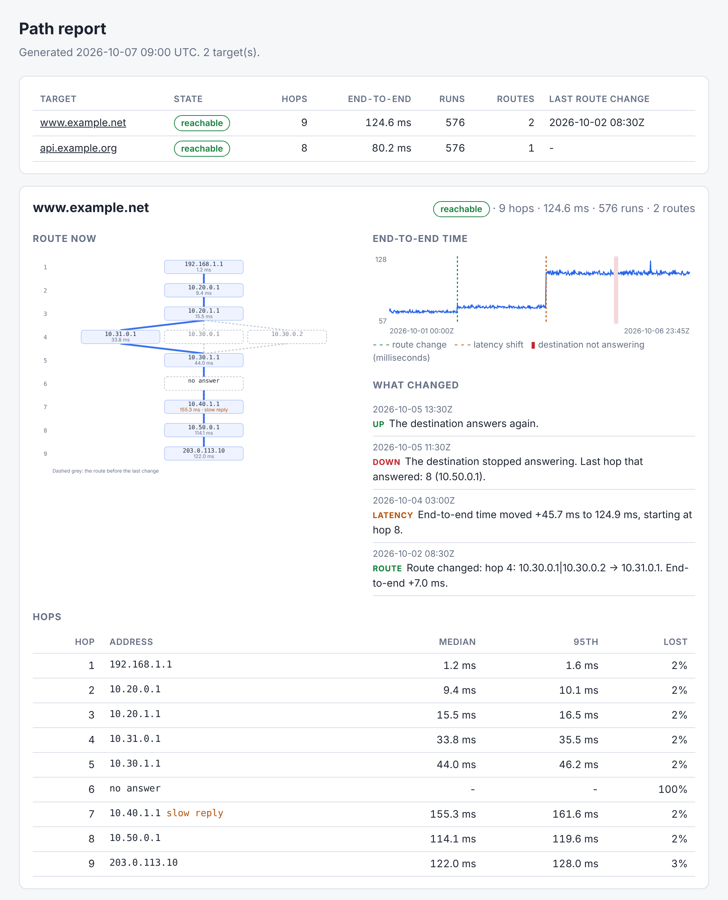

# pathmap: network path visualizer

[](https://github.com/TexAlphaWolf/net-traceroute-visualizer/actions/workflows/ci.yml)
[](https://github.com/TexAlphaWolf/net-traceroute-visualizer/actions/workflows/codeql.yml)

Runs `traceroute` (or `tracert` on Windows) again and again, keeps the history of every path, and tells you **when the
route changed, when the latency moved and which hop did it, and when the destination stopped answering**. The report is
one HTML page with a hop map and a timeline. Python standard library only, no dependencies.



*The screenshot is a synthetic network made for the picture (`tools/screenshot.py`): load balancing at hop 4, a firewall that never
answers at hop 6, a router that is slow to answer at hop 7, a reroute, a latency step and an outage.*

## Why not just compare two traceroutes?

Because two traceroutes of the same path are almost never identical. Load balancers send probes through different
routers, firewalls drop the probes, routers answer ICMP slowly. Comparing hop by hop raised an alert on **6135 of 7980**
comparisons of runs on paths that had not changed (6403 when the addresses were compared as sets). pathmap raised **0**, and still found
**141 of 141** real route changes in a simulated network with known changes. It learns which routers belong to a hop,
ignores a path that appears for a run or two, and tells a slow path from a router that is only slow to reply.

## Quick start

```bash
git clone https://github.com/TexAlphaWolf/net-traceroute-visualizer && cd net-traceroute-visualizer
pip install .
pathmap watch 1.1.1.1 example.org --interval 5m      # leave it running (Ctrl+C stops it)
pathmap report --out report.html                     # in another terminal, or later
```

With Docker (the image contains `traceroute`; the history is in the volume):

```bash
docker build -t pathmap .
docker run --rm -v pathmap-data:/data pathmap trace 1.1.1.1 example.org
docker run --rm -v pathmap-data:/data pathmap status
```

On Windows `tracert` is used and nothing has to be installed. On Linux install `traceroute` (`apt install traceroute`).

## Commands

| command | what it does |
|---|---|
| `trace TARGET...` | trace the targets once and store the result |
| `watch TARGET...` | trace again and again (`--interval 5m`, `--rounds N`) |
| `parse FILE` | read a saved `traceroute` or `tracert` output (`-` for standard input), `--store` adds it to the history |
| `changes` | list route changes, latency shifts and outages (`--since 7d`, `--fail-on-change`) |
| `show TARGET` | the current route hop by hop: median, 95th percentile, loss |
| `report` | write a report: `--format html` (default), `md`, `json` or `text`; `--anonymize` to publish it |
| `status` | one line per target; exit 1 if one is down or has not been traced lately (`--stale 1d`) |

Exit codes: 0 fine, 1 a problem was found (a trace failed, `--fail-on-change` with something to list, a target down or stale),
2 wrong command line. This makes `status` and `changes --fail-on-change` usable from cron, a systemd timer or a monitoring
check (see `examples/`).

## How it decides

- **Route change.** A run *agrees* with a route when every address it shows was already seen at that hop (silent hops
  agree with anything). When 3 runs in a row disagree (`--confirm`), the route changed, and the tool names the first
  hop that differs and whether the path is longer, shorter, or just has other routers in a balanced group.
  A path that shows up for fewer runs than that is a blip and is not reported (if it keeps coming back it is listed as an
  alternate path).
- **Load balancing.** All the routers seen at a hop are the route. The first 8 runs after a start or a change are used
  to learn them, and a router that disappears while its hop keeps answering is reported once the evidence is strong enough.
- **Latency.** The end-to-end median of each run is compared with the previous 20 runs. A step has to be larger than
  `max(8 ms, 10% of the usual time, 4 robust standard deviations)` and last. The hop named is the first after which
  every later hop moved as well, not the one with the largest jump (a slow router makes a jump the path does not have).
- **Outage.** 3 runs in a row without an answer from the destination, after it had answered before; and the recovery.

Details and the module layout are in [docs/architecture.md](docs/architecture.md).

## Measured results

From `docs/report.json`, a full run on a simulator with known truth (details and the way it is built in
[docs/evaluation.md](docs/evaluation.md); the simulator is not the internet, see [docs/limitations.md](docs/limitations.md)).

- Text read correctly: **3000 of 3000** runs of each format (Linux, Linux with names, Windows).
- Route changes found: **141 of 141**, 0 false alarms in 8000 runs of paths that did not change; the first differing hop exact in 80 of 82 and within one hop in all 82; a median of 2 runs after the change.
- Latency shifts found: **52 of 54**, hop named correctly 52 of 52 (the "largest jump" rule: 37 of 54); the two missed were too small to matter.
- Outages: **21 of 21**, with the recovery 21 of 21.
- Cost: 100 destinations with 1000 runs each are analysed in 2.9 s, about 750 bytes per run on disk.

## Security and data

- `traceroute` is started with an argument list, never a shell; a target is accepted only as an IP address or a plain host
  name (no leading `-`, no spaces or path characters), and everything read back from the history or from the program is validated.
- The HTML report has no script and no external file, and everything that comes from a trace is escaped.
- See [SECURITY.md](SECURITY.md).

**A report shows the routers on your path, and often your own addresses.** Before you publish one, run it with
`--anonymize` (addresses and names become `node-xxxxxx` labels). The history files in `pathmap-data/` are never meant to be committed.

## Development

```bash
pip install -e ".[dev]"
ruff check . && ruff format --check . && mypy && pytest -n auto --cov
python tools/evaluate.py --quick          # a few seconds; without --quick the full evaluation
```

Python 3.11 to 3.14. See [CONTRIBUTING.md](CONTRIBUTING.md). Part of a portfolio of network and security projects.

## License

MIT - Luca Tessitore
