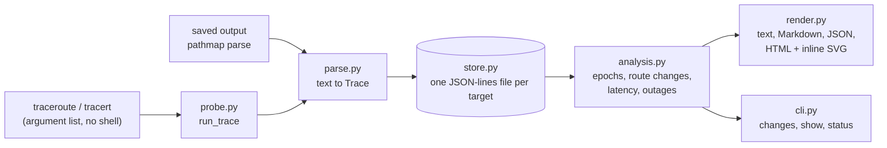

# Architecture

| module | job |
|---|---|
| `model.py` | `Probe`, `Hop`, `Trace`; validation of targets and addresses; the compact JSON form |
| `parse.py` | text of `traceroute` (Linux, macOS) and `tracert` (Windows, English and Italian) to a `Trace`. It looks at the shape of a line (numbers, addresses, `*`), not at words, so it does not depend on the language |
| `probe.py` | builds the command line for each system and runs it with a timeout and `LC_ALL=C` |
| `store.py` | append-only history, one file per target; a damaged line is skipped and counted, a truncated last line does not swallow the next record |
| `analysis.py` | the detection described below |
| `render.py` | reports, the hop ladder and the timeline as SVG, the anonymiser |
| `cli.py` | the commands and exit codes |

## Detection

The history of a target is cut into **epochs**: periods with one route. An epoch remembers, per hop, which addresses
answered and how often, which makes load balancing part of the route.

1. A run conforms to the epoch when every address in it is known at that hop. Silent hops are wildcards.
2. `confirm` (3) non-conforming runs in a row close the epoch. The new epoch inherits what was not replaced (hops that still
   answer), otherwise a router of an untouched hop would look like a second change.
3. In the first 8 runs of an epoch an address that neither this nor the previous epoch knows is learned, not reported:
   it is probably another member of a balanced group. A return to the previous route is not absorbed.
4. A known address that stops appearing while its hop keeps answering is tested statistically (share before, number of
   runs without it): an unbalanced change.
5. Latency: base window of 20 end-to-end medians, recent window of 5; each shift restarts the baseline.
6. The hop of a shift is the first one after which every later hop moved by at least 60% of the shift.

Everything is a pure function of the stored history, so a report can be regenerated at any time and the same input gives
the same output; the parameters are in `Params`.
